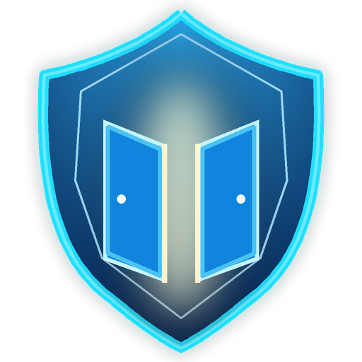

# КВН для Windows

**КВН** — VPN-клиент Windows 10/11 x64 с переключением **AmneziaWG 3.1** и **CSQTT**.

## Скачать и установить
В [Releases](../../releases) скачайте архив KVN-Windows-v0.2.1-beta.1-x64.zip, полностью распакуйте в отдельную папку и запустите KVN.Windows.exe с правами администратора. Нужен **Microsoft .NET 8 Windows Desktop Runtime x64**.

**Важно:** это beta. Старые VPN-клиенты удалять не нужно.

## Как подключиться
1. В разделе **Конфигурации** импортируйте AmneziaWG файл .conf или CSQTT файл .kvn.
2. Откройте **Подключение**, выберите протокол и профиль.
3. Нажмите на большой круг для подключения, повторно — для отключения.

Peer, пароль и VK-хеши в CSQTT берутся из .kvn. Настройки и секреты профилей CSQTT защищаются Windows DPAPI. Конфигураций или ключей в архиве нет.

## Что реализовано
- Единый светлый интерфейс с оригинальной иконкой открытых ворот из Android-КВН.
- AmneziaWG 3.1 / CSQTT, один активный туннель за раз.
- Сохранение профилей, диагностика и временные фильтры Windows Filtering Platform против исходящего IPv6 в режиме CSQTT.
- Подключения обоих протоколов опробованы пользователем; Windows-сборка и тесты загрузки окна, профилей, DPAPI и WFP прошли.

## Известные ограничения beta
Полная проверка DNS/IPv6-утечек на разных сетях, восстановление после сна и конфликты с другими VPN ещё не завершены. Не запускать поверх активных сторонних VPN. Проверять DNS/IPv6 перед использованием в критичных задачах.

## Лицензии и атрибуция
CSQTT — [PolyForm Noncommercial 1.0.0](LICENSE); правообладатель amurcanov, коммерческое использование требует отдельной лицензии. Обязательные уведомления находятся в LICENSE. AmneziaWG — [MIT](licenses/AWG-MIT.txt). Исходники и бинарные компоненты распространяются без гарантий.

## Исходники
WPF проект: windows-client/; компиляция: dotnet build windows-client/VPNSL.Windows.csproj -c Release. Для работы требуются client.exe, amneziawg.exe, awg.exe и wintun.dll, входящие в архив релиза. Исходники дополнительных движков находятся в соответствующих upstream-проектах.

GitHub: https://github.com/Nakortanax/KVN-Windows
Forgejo (локальный адрес): http://192.168.1.73:3100/igor/KVN-Windows

**English:** KVN for Windows x64 is a dual-protocol AmneziaWG 3.1 / CSQTT portable VPN client. The beta requires .NET 8 Windows Desktop Runtime and administrator rights; CSQTT is for noncommercial use only.
